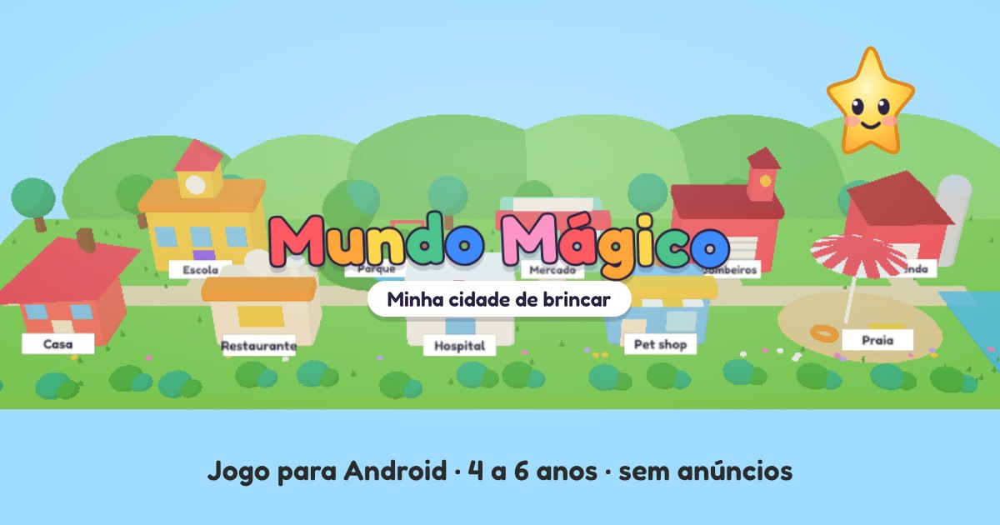
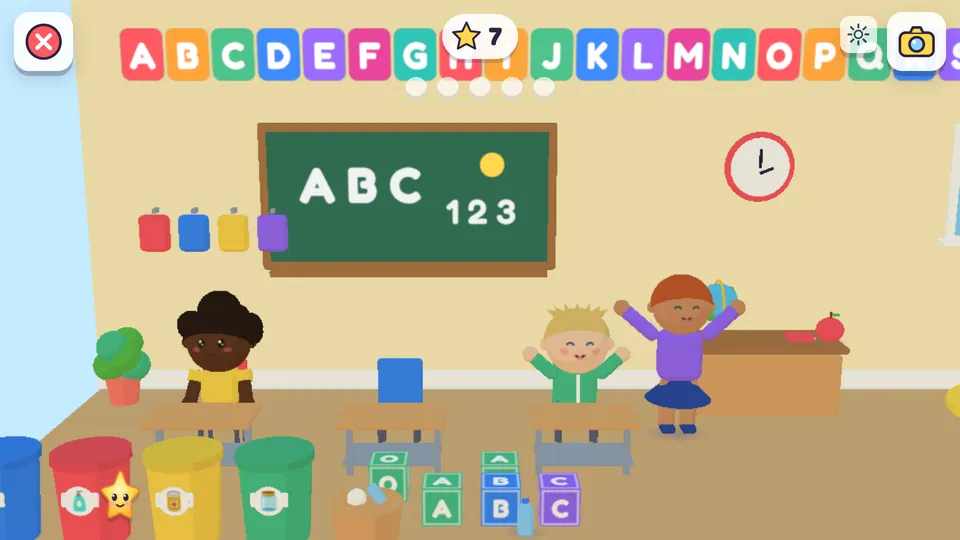
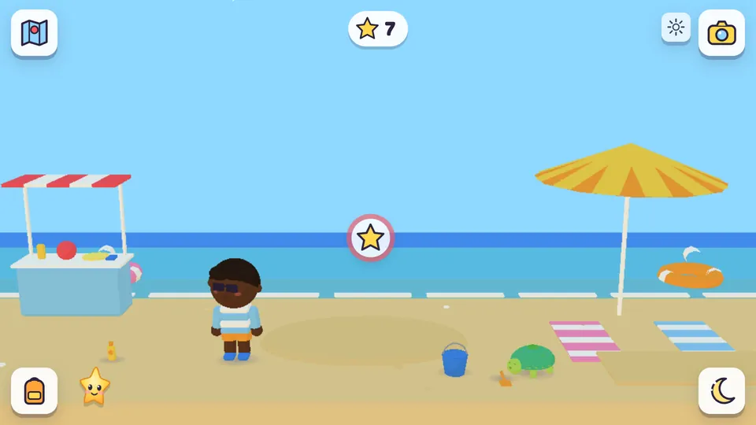
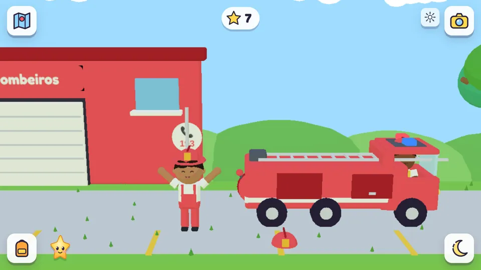
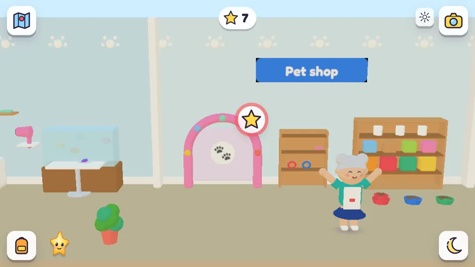
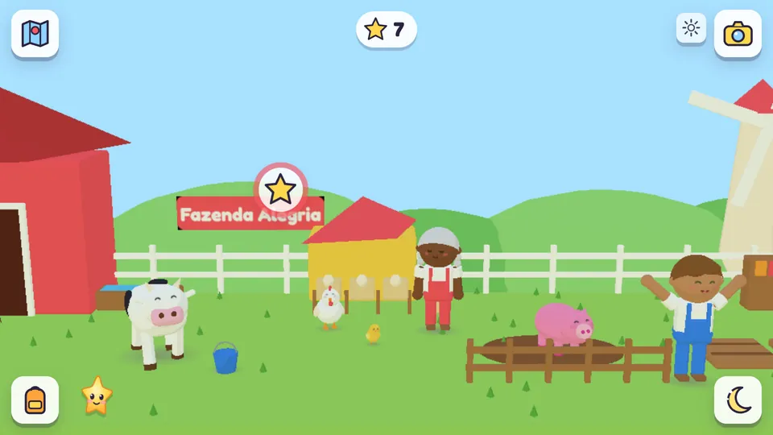
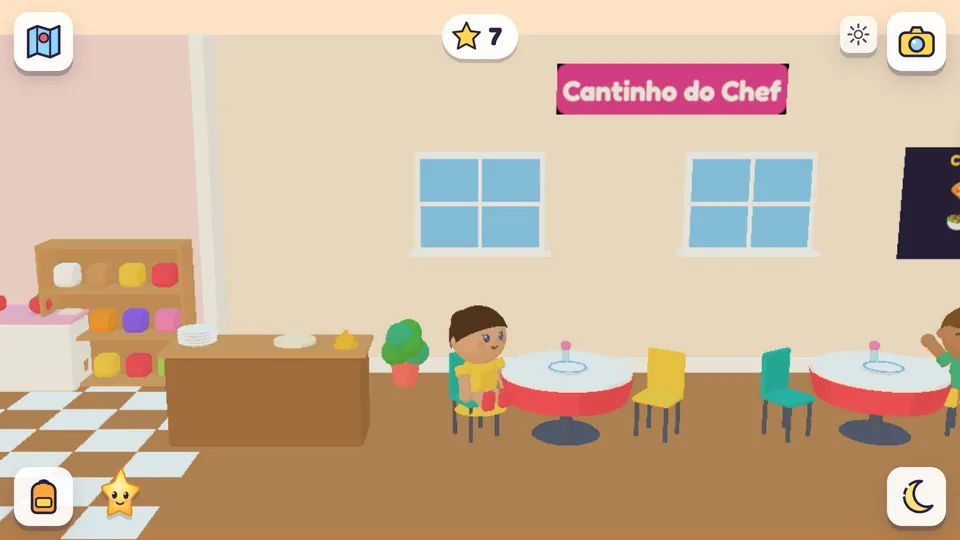

# Mundo Mágico — Minha cidade de brincar

Jogo infantil para Android, de 4 a 6 anos, feito pela [SrChZ Technologies](https://www.srchz-technologies.com.br/). Uma cidade inteira para a criança brincar do jeito dela: arrastar os personagens, abrir a geladeira, dar banho no cachorrinho, apagar o fogo de treino com os bombeiros e inventar as próprias histórias. Sem vitória, derrota nem cronômetro.

**[Baixar na Google Play](https://play.google.com/store/apps/details?id=br.com.srchztechnologies.mundomagico)** · [Página do jogo](https://www.srchz-technologies.com.br/mundo-magico/) · [Política de privacidade](https://www.srchz-technologies.com.br/mundo-magico/privacidade.html)

> Este repositório é a vitrine do jogo. O código é privado.

## Em números

- 10 lugares, 51 personagens, 157 itens e 17 atividades com narração.
- 3 idiomas: português, espanhol e inglês.
- Grátis para baixar. A Casa e a Escola vêm completas; os outros lugares abrem por compra na Área dos pais, com a cobrança feita pela Google Play.

## Telas

| | |
|---|---|
|  |  |
|  |  |
|  |  |

## Seguro para a família

- Sem chat: ninguém de fora fala com a criança.
- Sem cadastro e sem links para fora na área da criança.
- Não coleta dados. Progresso, fotos e gravações ficam só no aparelho.
- Funciona sem internet e salva sozinho.
- Toda compra fica na Área dos pais, protegida por uma pergunta para adultos.

## Como foi feito

- Cenários e personagens em 3D com three.js, empacotados para Android com Capacitor.
- Narração em português, espanhol e inglês, com vozes neurais licenciadas, ícones grandes e um tutorial guiado: a criança não precisa saber ler.
- Publicado na Google Play pela conta da SrChZ, depois do teste fechado de 14 dias que a loja exige.

## Quer um app ou jogo assim?

A SrChZ cria apps e jogos para empresas, escolas e órgãos públicos, do conceito à loja, e publica na conta do cliente.

- Serviços: https://www.srchz-technologies.com.br/tech/
- Portfólio: https://www.srchz-technologies.com.br/portfolio/
- Contato: contato@srchz-technologies.com.br · WhatsApp (11) 9 9686-9309

---

## In English

**Mundo Mágico — Minha cidade de brincar** (Magic World — My Play City) is an Android game for children aged 4 to 6, made by SrChZ Technologies. A whole town for the child to play their own way: drag the characters around, open the fridge, give the puppy a bath, put out the practice fire with the firefighters and make up their own stories. No winning, no losing, no timer.

**[Get it on Google Play](https://play.google.com/store/apps/details?id=br.com.srchztechnologies.mundomagico)** · [Game page](https://www.srchz-technologies.com.br/mundo-magico/) · [Privacy policy](https://www.srchz-technologies.com.br/mundo-magico/privacidade.html)

> This repository is the game's showcase. The source code is private.

- 10 places, 51 characters, 157 items and 17 narrated activities, in Portuguese, Spanish and English.
- Free to download: the House and the School are complete; the other places unlock through purchases in the parents' area, billed by Google Play.
- No chat, no sign-up and no outside links in the child's area. No data collection: progress, photos and recordings stay on the device. Works offline.
- Built in 3D with three.js and packaged for Android with Capacitor.

SrChZ builds apps and games for companies, schools and public bodies, from concept to store listing, published under the client's own account: https://www.srchz-technologies.com.br/?lang=en

---

© 2026 SrChZ Technologies. Todos os direitos reservados. Os personagens, as ilustrações e os textos do jogo são originais.
